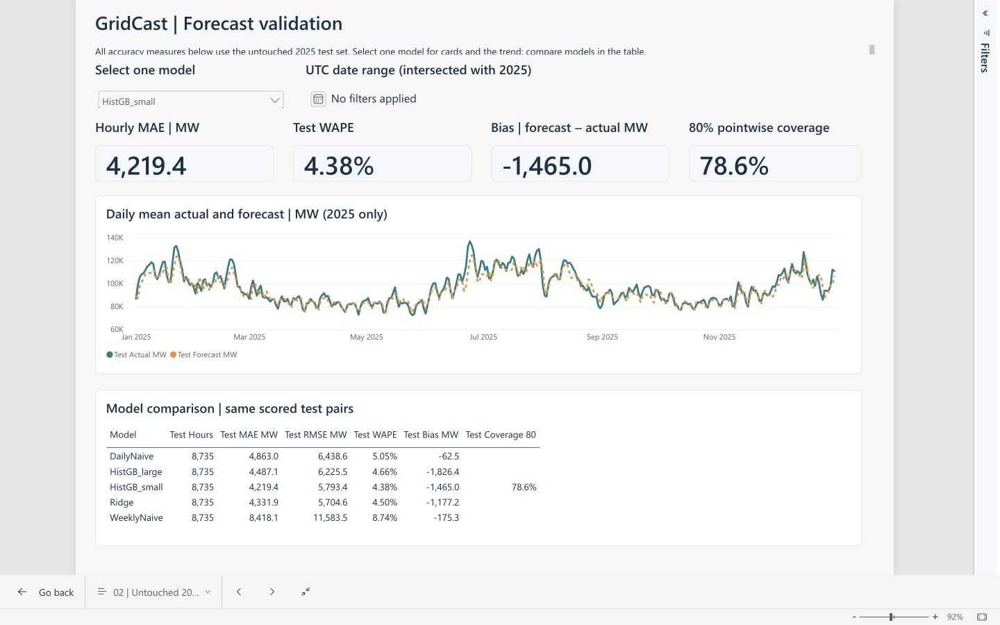
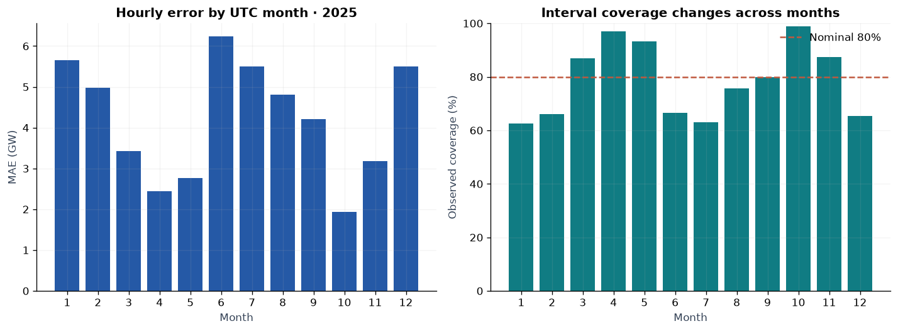

# GridCast · PJM energy demand forecasting

A reproducible historical forecasting study and Power BI decision-support prototype using official EIA-930 PJM regional demand. Forecasts are issued once per UTC day for the following 24 hours.

**First-release result:** the validation-selected histogram gradient boosting model achieved **4.38% WAPE** and **4,219 MW MAE** on **8,735 valid 2025 hours**. MAE improved **13.2%** versus the stronger naïve comparator, yesterday's same hour. Its nominal 80% intervals covered **78.6%**; high-demand underprediction is a material limitation. Coverage is only **47.95% during high-demand hours**. Ridge has slightly lower test RMSE, so the selected model is not best on every metric.

**Status:** the Python study and a real **Power BI Service report** are built and verified. The saved Service report has four pages and 35 visuals; its model has 28 persistent measures, a completed manual refresh, reconciled DAX results, and genuine report screenshots. Observed model/date filters work. **Windows PBIP/Desktop compatibility remains untested.** This is a historical prototype, not an operational forecast or a study of outages, reliability, prices, or savings.

## Recruiter quick view

[Read the case study](reports/CASE_STUDY.md) · [View all four Power BI pages](powerbi/SERVICE_VALIDATION.md#saved-report-and-observed-interactions) · [Review the executed notebook](notebooks/GridCast_Analysis.ipynb) · [Inspect the code](src/gridcast/core.py)



**What to assess:** chronological forecasting evaluation, reproducible Python analysis, data-quality decisions, dimensional modeling, DAX, and clear communication of uncertainty. The screenshots and code are public and can be reviewed without a Power BI account. The interactive Service report remains private.

## Verification update · 31 October–1 November 2026

A deeper review reproduced the full model pipeline and notebook on both macOS and Linux, added adversarial source/availability tests, and fixed headless notebook chart retention. All 22 tests pass. The Power BI source contains 35 visuals and 28 measures; 45 official report/project schema checks and expanded source checks pass. Actual Service engine exports now reconcile the five-model scorecard, twelve filter contexts, history totals, blank/zero behavior and import integrity against Python.

The observed 2025 result remains unchanged. The 25 missing test actuals are one contiguous gap around the autumn clock change, and high-demand interval coverage is only47.95%. A fixed-specification sensitivity retaining the four manual training spikes changes MAE by0.16%; this does not confirm the spikes as operator errors. See the [review and remaining gates](outputs/verification/REVIEW_2026-10-31.md) and [robustness evidence](outputs/verification/ROBUSTNESS_REVIEW.md).

The browser validation created and saved a separate Service model/report from the frozen exports. Four report pages and the baseline/June filter states were inspected and captured. The default landing page is demand history. [Service evidence and limits](powerbi/SERVICE_VALIDATION.md) distinguish these completed checks from untested Windows compatibility, PBIX download/export, and public-link access. The interactive Power BI Service report remains private in the owner's workspace with no sharing links. Repository and case-study publication were authorized separately on 1 November 2026. An unexpected automatic trial notice appeared in the Service; no Start trial, upgrade, billing or terms action was taken, and access after expiry has not been established.

## Start here

- [Case study and findings](reports/CASE_STUDY.md)
- [Executed notebook](notebooks/GridCast_Analysis.ipynb) and [portable output preview](reports/notebook_preview.html)
- [Power BI project and native validation instructions](powerbi/README.md)
- [Verified Service report, screenshots and runtime receipts](powerbi/SERVICE_VALIDATION.md)
- [Complete project blueprint and 10-week plan](docs/PROJECT_BLUEPRINT.md)
- [Source provenance and quality decisions](docs/SOURCES.md)
- [Publication checklist](docs/PUBLICATION_CHECKLIST.md) and [resume / LinkedIn drafts](docs/PORTFOLIO_AND_CAREER.md)
- [Model card](docs/MODEL_CARD.md), [data dictionary](docs/DATA_DICTIONARY.md), and [validation receipt](outputs/VALIDATION.md)



## Reproduce the analysis

Use **Python 3.12**. The pinned canonical CSV is included, so reproducing the experiment needs no API key and no fresh data download.

```sh
python3.12 -m venv .venv
source .venv/bin/activate
python -m pip install -r requirements-lock.txt
python scripts/run_pipeline.py
python -m unittest discover -s tests -v
python scripts/build_analysis.py
python scripts/write_release_docs.py
python powerbi/validate_assets.py
python powerbi/reconcile_exports.py
```

The notebook builder starts a local Jupyter kernel and saves an executed notebook with embedded charts. Its HTML file is an output-inspection preview; it is not Power BI rendering. All modeling uses deterministic configurations, with small floating-point variation possible across platforms. `requirements-lock.txt` records the environment actually used.

Optional source restoration:

```sh
python scripts/fetch_eia_pjm.py
```

The original workbook is 114 MB and excluded from Git. This command verifies its pinned checksum and reproduces the canonical extract. If EIA's latest workbook has changed, it refuses to replace the pinned experiment; use the included CSV. `--refresh` intentionally creates a new source vintage and requires reviewing the audit, tests, results, and publication claims again. Keep the old manifest/results under version control.

## Experiment contract

| Period | Role |
| --- | --- |
| 2019–2022 | Initial candidate fitting |
| 2023 | Selection by MAE |
| 2019–2023 | Final fixed point-model fitting |
| 2024 | Champion interval calibration, separately by horizon |
| 2025 | Frozen final test |
| 1 January 2026 UTC | Unscored historical next-day illustration |

Features include Eastern calendar cycles, lags 24/48/168/336, and rolling summaries shifted 24 hours. They read only prior-day or older demand for every target horizon. The experiment assumes previous-hour demand access; the revised public EIA archive and its reporting lag do not establish operational availability. Source revisions and ex-post quality flags make this a retrospective cleaned-data benchmark.

The source has 61,368 unique UTC hours. We exclude 178 invalid measured targets and use causal prior-week/day/hour replacements only in a separate feature-input series. Replacements never become scored actuals. Energy totals cover valid observed hours and show completeness. Weather is a later extension requiring archived issued forecasts and a fresh holdout.

## Repository map

```text
data/raw/         Pinned PJM extract, workbook notes, audit and checksums
data/processed/   Clean measured target, flags and separate causal input series
data/powerbi/     FactDemand, FactForecast, DimDate and DimModel CSVs
src/gridcast/     Auditing, causal fill, safe features, metrics and intervals
scripts/          Acquisition, experiment, executed analysis and narrative builders
models/           Selected fitted model
outputs/          Scores, diagnostics, quality, run summary and evidence receipt
notebooks/        Executed analysis with embedded figures
reports/          Case study, seven charts and notebook output preview
powerbi/          Native PBIP/report/model source, M, DAX, theme and QA tools
docs/             Blueprint, sources, model card, dictionary and publication materials
tests/            Meaningful availability and independent reconciliation checks
```

## Publication boundary

The completed Power BI implementation was validated in **Power BI Service**: real refresh, persistent DAX, numerical/context parity, rendering and the observed slicer states have evidence. Its [actual test page](outputs/verification/screenshots/06_service_test_page.jpg) is a Service screenshot. This does not prove that [GridCast.pbip](powerbi/GridCast.pbip) opens in Windows Desktop; all nine Desktop checks remain open for anyone claiming that separate compatibility.

Do not claim production deployment, avoided outages, reduced procurement cost, grid reliability gains, emissions savings, or a downloaded PBIX. The validation assets were created in the signed-in account. Public repository/case-study publication was authorized on 1 November 2026; current link-test results are recorded in [the public release receipt](docs/PUBLIC_RELEASE.md). The interactive Power BI report remains private, and a LinkedIn post is supplied for review rather than posted automatically.

Source: [U.S. Energy Information Administration, Form EIA-930 PJM workbook](https://www.eia.gov/electricity/930-content/about.html), retrieved 2026-10-27. See [reuse terms](https://www.eia.gov/about/copyrights_reuse.php). Independent project; no EIA/PJM endorsement. Code is MIT licensed; source data terms are separate.
