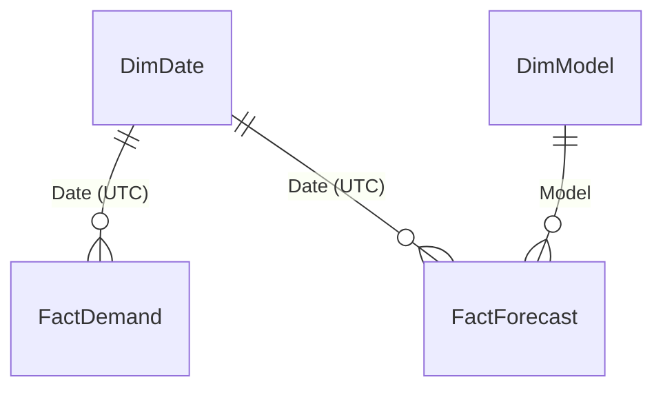

# GridCast Power BI implementation

This folder contains an authored Power BI Desktop project, not a downloaded or refreshed PBIX. It includes a four-table semantic model, 28 DAX measures, Power Query imports, and four report pages containing 35 visuals. The 45 JSON files pass Microsoft's public PBIP/PBIR schemas. **A separate reconstructed Power BI Service report has now passed real refresh, persistent DAX parity, rendering and observed model/date filter checks.** See [Service evidence and screenshots](SERVICE_VALIDATION.md). Opening the local PBIP in Windows Desktop remains untested; Microsoft documents Desktop as a Windows application and supports [Azure Virtual Desktop and Windows 365](https://learn.microsoft.com/en-us/power-bi/fundamentals/desktop-get-the-desktop).

Any unexecuted native flags in the portable archive's START_HERE/snapshot refer to that local PBIP/Desktop artifact, not the separately saved and verified Service report. Service layout refinements do not imply byte-identical PBIR source or a completed PBIX export.

## Open and refresh

1. Finish the Python pipeline in the repository README. Confirm that all four CSVs exist under `data/powerbi/`.
2. Copy or clone the repository onto the Windows machine used for Power BI Desktop. Open `powerbi/GridCast.pbip` in a current Desktop release. If the installed release asks you to enable project/report format support, follow its prompt and restart Desktop.
3. In **Transform data → Edit parameters**, set `DataFolder` to the full Windows path of `data/powerbi`, for example `C:\GridCast\data\powerbi`. This parameter is the only machine-specific path. Do not point it to `data/processed`, which has a different contract.
4. Apply changes and refresh. Resolve any reported import/type errors before proceeding. The project intentionally has no cached dataset, so opening it alone does not load the CSVs.
5. In Model view, confirm the three relationships shown below. Confirm `DimDate[Date]` has Date type, is unique, and is the date column when marking `DimDate` as the date table. Keep automatic date/time tables disabled. Sort `MonthName` by `MonthNumber`, `DayOfWeekName` by `DayOfWeekNumber`, and `DayOfWeekNameLocal` by `DayOfWeekNumberLocal`.
6. Import `GridCastTheme.json` using **View → Themes → Browse for themes**. The theme is supplied separately so Desktop can apply its current theme defaults.
7. On the test and historical-next-day pages, select the model identified as champion in the analysis outputs. In the current frozen run this is `HistGB_small`. Cards intentionally return blank when multiple or no models are selected. The comparison table ignores the model slicer and evaluates one model per row.
8. Complete every native check in `NATIVE_ACCEPTANCE.md`, then save as PBIP. Use Desktop **File → Save as** if a PBIX copy is needed. PBIP-to-PBIX conversion is a [Desktop operation](https://learn.microsoft.com/en-us/power-bi/developer/projects/projects-overview).

The authored visuals use built-in visual types only. If a newer Desktop release changes a visual property, fix and save the affected visual in Desktop, retain the exported PBIP, and rerun the structural validation. Do not claim a successful dashboard implementation until the refreshed report has been inspected.

## Data model



All relationships are active, many-to-one from facts to dimensions, with single filter direction from the dimension. There is no fact-to-fact relationship and no bidirectional filter. This follows Microsoft's [star-schema guidance](https://learn.microsoft.com/en-us/power-bi/guidance/star-schema).

| Table | Grain | Purpose |
|---|---|---|
| `FactDemand` | One complete UTC hourly slot | Historical observed demand, including null actuals for invalid/missing observations. Extra feature-imputed source columns are deliberately excluded by Power Query. |
| `FactForecast` | UTC hour × model × split | Forecasts, observed actuals, daily forecast origin, horizons 1–24, and champion-only interval bounds. |
| `DimDate` | One UTC calendar date | Shared date filtering; includes the historical forecast dates beyond the observation cutoff. |
| `DimModel` | One model | Model selection and comparison. |

`DateTimeUTC` and `ForecastOriginUTC` arrive as ISO 8601 strings ending in `Z`. Power Query parses them as timezone-aware values, explicitly normalizes them to UTC, then removes the timezone for the Desktop datetime type. It does not convert them to the computer's local zone. `Date` and `HourUTC` remain UTC. `DateLocal` and `HourLocal` come from Python's `America/New_York` conversion; Power Query derives only the local weekday from `DateLocal`.

The date slicers use UTC dates. The weekday/hour profile charts use PJM's local Eastern time. A repeated fall-back local hour represents two distinct UTC slots; a missing spring-forward local hour is not filled with synthetic demand. All aggregation weights individual observed hours.

## Demand and accuracy definitions

The source is **EIA-930 PJM balancing authority reported demand**, not a claim of a directly ingested PJM metered feed. EIA publishes hourly demand in MWh. For a one-hour interval, its numeric value equals the average MW during that hour. `ActualMW` and `ForecastMW` use this numeric equivalence; summing hourly mean MW × one hour gives MWh. An hourly mean peak is not an instantaneous system peak.

Invalid/missing actual demand remains blank. The Python feature-imputation series is not imported as observed demand. Historical energy is the sum of valid observed intervals only and is incomplete when the missing-hours card is nonzero; it is not an estimate of the missing energy. `Observed Hours` counts nonblank actuals; `Expected Hours` counts the complete UTC grid.

All measures named `Test …` explicitly use `Split = "test"` and valid actual/forecast pairs. Validation and calibration forecasts are available in the source fact but cannot enter these scorecard metrics. Future rows have no actual and never enter the accuracy denominator. No report slider changes the statistical test split.

| Metric | Definition |
|---|---|
| MAE, MW | Mean of absolute hourly forecast errors. |
| RMSE, MW | Square root of the mean squared hourly errors. |
| WAPE | Sum of absolute hourly errors ÷ sum of absolute actual hourly demand. Stored as a fraction and formatted as percent. Never average daily/model WAPE values. |
| Bias, MW | Mean forecast minus actual. Negative means underforecasting. |
| 80% coverage | Share of valid actual/forecast/interval pairs inside the pointwise nominal 80% interval. Nonchampion models have no intervals, so this is blank. |
| High-demand 80% coverage | Same pointwise coverage calculation restricted to actual demand at or above the fixed training p90; requires valid actual, forecast, lower and upper bounds. It is BLANK without valid high-demand intervals and0% when none of the valid intervals cover the actual. |
| Interval width, MW | Mean upper-minus-lower bound on valid test interval pairs. |

The daily actual/forecast line uses mean MW on the scored pairs for the selected model, with both lines on the same axis. It is not a plot of daily total energy. The future chart draws the forecast and two hourly bound lines. These are **pointwise** intervals, not a simultaneous 80% guarantee for all 24 hours. Summing/averaging bounds does not produce a valid daily-energy interval.

## Report pages

| Page | Contents | Review question |
|---|---|---|
| Demand history | UTC date slicer; observed energy, mean, hourly peak, completeness and missing-hour cards; daily trend; local weekday and local hour profiles. | What demand patterns recur, and how much trustworthy history supports them? |
| Untouched 2025 test | Model and UTC-date slicers; MAE, WAPE, bias, coverage; actual-vs-forecast daily mean on one axis; comparison table with valid-pair counts. | Does the selected model improve accuracy while avoiding unacceptable underforecasting? |
| Error and peak-risk diagnostics | Monthly MAE, bias by UTC hour, and count/MAE/bias/interval coverage for test hours above the fixed initial-training demand p90. | Where do large misses cluster, and how does the model behave during high demand? |
| Historical next day | Model selector; historical-only notice; hourly point forecast, lower/upper 80% lines and review table. | Which hours warrant the most planning attention, and how wide is the uncertainty? |

No live forecast for today's date is supplied. The last page uses the fixed historical cutoff from the reproducible pipeline. Read the timestamps in the table before presenting it.

The high-demand threshold is **111,972.4 MW** in the frozen run: the 90th percentile of valid initial training demand from 2019–2022 after the 336-hour feature warmup. It is loaded from the required `outputs/run_summary.json` when generating the assets. The high-demand test subset uses **observed** actual demand above this fixed threshold, so its results are retrospective diagnostics, not an advance alert rule. Current champion reference values are 1,487 hours, MAE 7,891.57 MW, and bias −6,592.89 MW; the negative bias shows material underforecasting during these hours.

## Validate and maintain the source

From the repository root:

```bash
python powerbi/build_assets.py
python powerbi/validate_assets.py
python powerbi/reconcile_exports.py
python powerbi/prepare_native_checks.py
```

`build_assets.py` regenerates the authored JSON, M, DAX, and theme from one source. It overwrites generated report/model files; preserve any Desktop refinements before regenerating. `validate_assets.py` checks the PBIP/PBIR against cached official Microsoft schemas, then checks model relationships and report field references. `--fetch-schemas` downloads missing schema dependencies from Microsoft's public schema host. Microsoft's embedded visual schema declares a dot-form ID but serves the hyphen-form URL; the validator records the actual served URL.

`reconcile_exports.py` independently verifies CSV grain, UTC continuity, local timezone fields, dimension keys, forecast/history actual agreement, future null actuals, origin/horizon ranges, and interval ordering. It produces:

- `validation/expected_test_metrics.csv`: exact expected scorecard values to compare with Desktop.
- `validation/export_reconciliation.json`: historical completeness and aggregate values.
- `validation/schema_validation.json`: schema check results and explicit native-runtime limitations.

These checks do not execute M, DAX, or the Power BI visual engine. The native acceptance checklist is an additional gate.

The 31 October source audit corrected empty-count/zero-coverage semantics and added explicit query sorting and row-major keyboard tab order; see `STATIC_AUDIT.md`. Counts return0 for an empty subset when exactly one model is in context; forecast accuracy remains BLANK when no scored pairs exist. No/multiple/zero-model contexts return BLANK for all guarded forecast measures. Coverage is0 when a nonempty interval subset covers no actuals, and BLANK when there are no valid interval pairs.

`prepare_native_checks.py` generates twelve independent expected filter contexts and four read-only DAX queries in `queries/`. Run those against a real refreshed model, then compare the actual raw exports using `verify_native_results.py` as explained in `queries/README.md`. The expected files are not native execution evidence.

## Build from a blank PBIX if needed

If the installed Desktop release cannot load the project format, create a blank report and make **six named blank queries** in this order using the `.pq` files in `powerquery/`: `DataFolder`, `ReadCsv`, `FactDemand`, `FactForecast`, `DimDate`, `DimModel`. Paste each expression into Advanced Editor; disable load on `DataFolder` and `ReadCsv`. Set the parameter, apply, create the three relationships, and add the measures in `measures.dax` to `DimModel`. Apply the model sort and date settings above. Recreate the four page layouts from the table and authored PBIR positions, import the theme, and complete the same native acceptance checks. This is a fallback construction path, not evidence that a PBIX has been built.

## Refresh and publication

Python owns acquisition, cleaning, modeling and the frozen export. Power BI owns the import, semantic metrics and presentation. **Refresh** reimports the current CSV exports; it does not retrain the model or fetch new EIA observations. This separation makes the displayed forecast traceable to the evaluated run.

The supplied local-file import needs an accessible path in the refresh environment. A Power BI service deployment using local files usually needs an [on-premises data gateway](https://learn.microsoft.com/en-us/power-bi/connect-data/service-gateway-onprem), or an explicitly redesigned cloud storage source. No unattended service refresh or credentials have been configured. A production extension would orchestrate the Python run, verify it, atomically replace the exports, then trigger semantic-model refresh and monitor failures.

If performing the separate Desktop checks, retain that refreshed PBIP/PBIX and expected-vs-Desktop receipt. Genuine screenshots of the four Service pages and real engine exports are already retained under `outputs/verification/`; their scope is documented in `SERVICE_VALIDATION.md`. Service assets were saved in the signed-in account, but no public embed, sharing link, repository release or social post was authorized or performed.

Implementation references: [project structure](https://learn.microsoft.com/en-us/power-bi/developer/projects/projects-overview), [report PBIR and JSON schemas](https://learn.microsoft.com/en-us/power-bi/developer/projects/projects-report), [semantic model definition](https://learn.microsoft.com/en-us/power-bi/developer/projects/projects-dataset), [Text/CSV import](https://learn.microsoft.com/en-us/power-query/connectors/text-csv). Data provenance and permitted claims are documented in the repository's `docs/SOURCES.md`.
