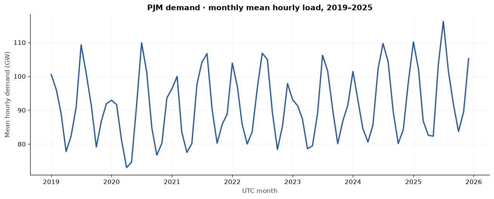
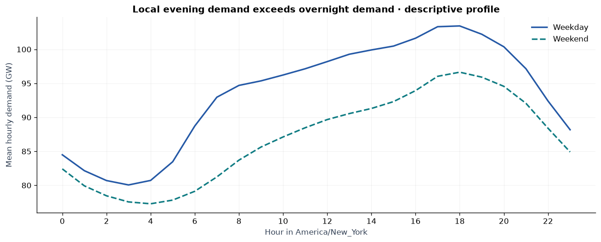
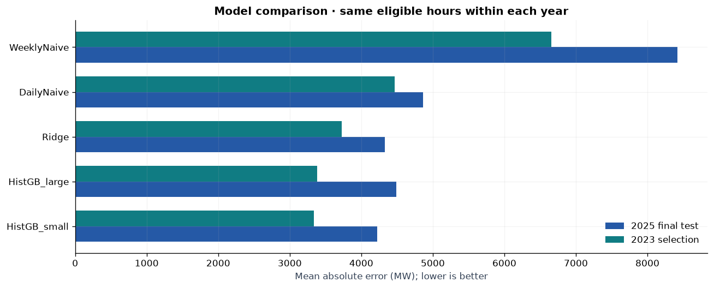
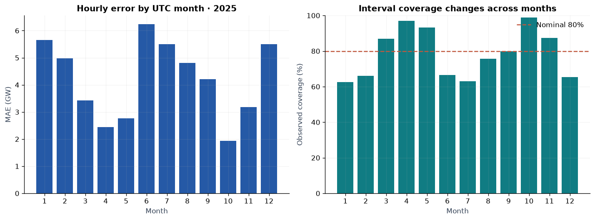
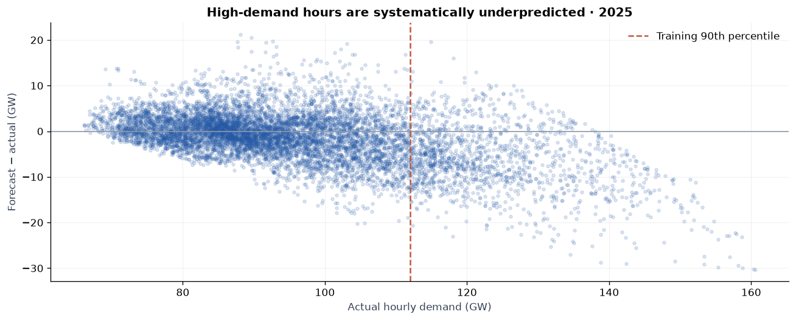
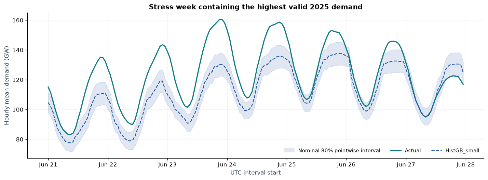
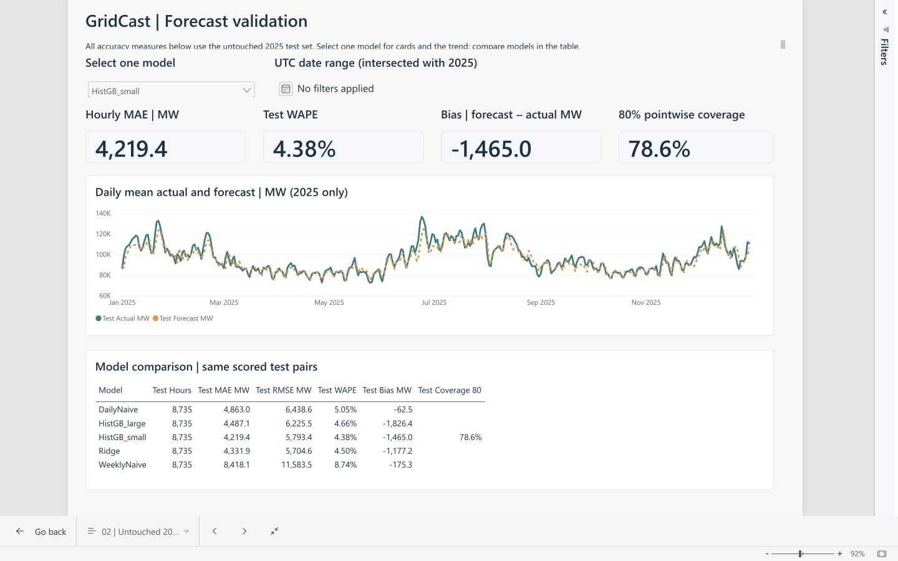
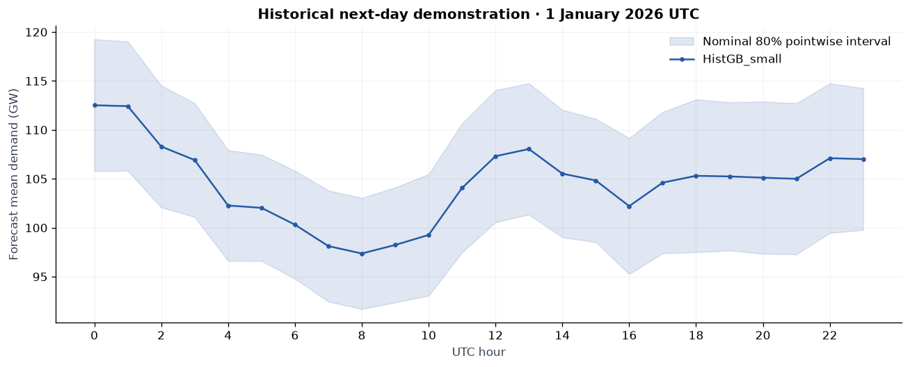

# GridCast: PJM energy demand forecasting

[Repository overview](../README.md) · [Recruiter quick view](../docs/RECRUITER_GUIDE.md) · [Power BI screenshots and validation](../powerbi/SERVICE_VALIDATION.md)

## Decision and result

Can a compact calendar-and-demand model improve on simple daily persistence while making its uncertainty and failures visible? On **8,735 valid hourly actuals in 2025**, the model selected using 2023 MAE achieved **4,219 MW MAE** and **4.38% WAPE**. MAE was **13.2% lower than yesterday's same-hour baseline**, the stronger of the two naïve comparators.

The result supports using this model as an analyst review aid. It underpredicts high demand and should not be described as dispatch-ready. Its nominal 80% pointwise intervals covered **78.6%** of valid test hours. **Only 47.95% of high-demand hours are covered.** Aggregate accuracy hides weak uncertainty coverage during stressed demand.

This is a historical forecasting study and decision-support prototype. No outage, grid-reliability, price, savings, or emissions outcome was measured.

## Source and cleaning

The population is the **PJM balancing authority**, using official [EIA-930 hourly data](https://www.eia.gov/electricity/930-content/about.html). It is not a single PJM utility zone. The frozen workbook was retrieved on **27 October 2026**; observations cover UTC interval starts from 1 January 2019 through 31 December 2025. EIA reported demand is not asserted to equal PJM's market-settled load product.

The extract contains **61,368 unique UTC hours**. EIA's hour-ending timestamps are shifted back one hour. One-hour MWh divided by one hour is mean MW; peak MW and time-summed MWh have separate labels. Calendar features use America/New_York; splits, daily origins, and annual summaries use UTC.

Cleaning masks **178 target observations**: 167 missing originals, seven additional EIA-flagged values, and four reviewed spikes confined to the 2020 training period. The four are analyst-inferred anomalies, not operator-confirmed corrections. Raw originals and quality fields are preserved. Past-only replacements supply historical features where necessary, but never become scored actuals. Twenty-five 2025 actuals are missing, leaving 8,735 scored hours. The source ledger, original checksums, and anomaly review are in [SOURCES](../docs/SOURCES.md) and [anomaly_review.csv](../docs/anomaly_review.csv).

The 25 missing test actuals form one contiguous gap from 2 November 2025 04:00 UTC through 3 November 04:00 UTC, around the Eastern autumn clock change. Observed-hour accuracy does not validate that missing transition. Annual energy tables sum only valid measured hours and show completeness. They do not estimate the missing hours' energy.

Recurring seasonal and local-hour patterns justify seasonal baselines and calendar features. These are descriptive associations; no weather or causal driver was measured in this release.

## Protocol fixed before test evaluation

| Stage | Period | Use |
| --- | --- | --- |
| Initial fit | 2019–2022 | Fit fixed candidate specifications and preprocessing |
| Model selection | 2023 | Choose minimum hourly MAE on common valid timestamps |
| Final point-model fit | 2019–2023 | Refit each fixed candidate once for later comparison; selected champion fixed here |
| Interval calibration | 2024 | Derive 24 horizon-specific nominal 80% residual radii for the champion |
| Final test | 2025 | Evaluate frozen model and interval rule; no tuning |

At each midnight UTC origin, predict the 24 intervals beginning at the origin. Horizon 1 is the origin's first hour and horizon 24 its last. All features read demand strictly before the origin: lag 24/48/168/336, and rolling summaries shifted 24 hours. Target-day and later actuals can be perturbed without changing any of the 24 feature rows. Scaling lives inside the Ridge training pipeline.

This assumes access to the last completed hour. EIA's public reporting latency and revised history do not prove that assumption. Source quality flags are also retrospective. Therefore, this is a **cleaned historical benchmark**, not a vintage-preserving replay of a live EIA-only feed. A production protocol would require issued snapshots, latency handling, and a new evaluation.

The candidate set contains daily and weekly persistence, Ridge, and two bounded histogram gradient boosting configurations. The smaller tree configuration won 2023 MAE; test results did not choose it. Weather and holiday features are deferred, not hidden completed work.

## Test evidence and tradeoffs

| Model | MAE (MW) | RMSE (MW) | WAPE | Bias (MW) |
| --- | ---: | ---: | ---: | ---: |
| HistGB_small | 4,219 | 5,793 | 4.38% | -1,465 |
| Ridge | 4,332 | 5,705 | 4.50% | -1,177 |
| HistGB_large | 4,487 | 6,225 | 4.66% | -1,826 |
| DailyNaive | 4,863 | 6,439 | 5.05% | -62 |
| WeeklyNaive | 8,418 | 11,584 | 8.74% | -175 |

All rows use the same 8,735 valid test hours. The primary improvement is against **DailyNaive**, not the much weaker weekly baseline. Ridge has lower test RMSE than the selected model, so the conclusion depends on the fixed validation-MAE objective. The project does not compare against PJM's own operational forecast because issue times and revisions were not aligned.

A paired seven-day moving-block bootstrap estimates a mean MAE gain of **644 MW**, with a descriptive 95% percentile interval of **255–1,026 MW**. The bootstrap uses 2,000 samples and seed 42. One year's blocks do not establish future-year performance, causality, or realized savings.

## Where predictions fail

- **High demand:** above the fixed initial-training 90th percentile (111,972.4 MW), 1,487 test hours have **7,892 MW MAE** and **-6,593 MW bias**. Large underprediction is a practical reason for analyst review.
- **Seasonal stress:** June MAE is about 6,245 MW versus about 1,943 MW in October. June interval coverage is only 66.5%; January and July are also weak. Weather is a plausible next hypothesis, not an established explanation.
- **Peak magnitude:** daily peak MAE is **5,025 MW** over 363 days with 24 valid measured hours. This compares daily maxima and does not measure peak timing accuracy.
- **Uncertainty:** average test interval width is **13,185 MW**. The bands are pointwise prediction intervals, with no simultaneous-path or guaranteed distribution-free coverage claim under serial dependence and drift.
- **Persistent misses:** residual autocorrelation is 0.97 at one hour and 0.33 at 24 hours on the regular UTC grid. Errors arrive in runs; independent-hour uncertainty assumptions would be misleading. The largest saved test miss is about 30.3 GW during the June stress event.

The following stress view is deliberately selected to contain the largest valid 2025 demand. It exposes a failure case rather than representing a randomly chosen week.

## Actionable next steps

1. Show the demand path, calibrated range, and high-demand underprediction warning together for analyst review. Do not use a mean accuracy number as an operational reserve rule.
2. Test archived, issued weather forecasts and explicit holiday calendar effects in a new experiment. For PJM, use representative regional stations or geographic weights; a single city's realized temperature is insufficient for an honest regional forecast.
3. Evaluate a rolling refit and regime drift using a new holdout or nested forward validation. Keep this 2025 result frozen as the initial benchmark.
4. Obtain an as-of data feed with a verified publication delay before attempting deployment. Re-evaluate every feature under that delay.

## Power BI implementation and evidence status

The authored [Power BI project](../powerbi/GridCast.pbip) includes native report definitions, an import semantic model, Power Query, DAX, a theme, and four CSV facts/dimensions. Demand totals use one history fact; forecast scores require one model, exclude missing actuals, and aggregate WAPE from its numerator and denominator. The source includes demand patterns, test comparison, uncertainty, and failure diagnostics.

The saved **Power BI Service** implementation now has four pages and 35 visuals. It uses 28 persistent measures, three canonical active one-way relationships, a completed manual refresh, and real standalone DAX exports reconciled to Python. Service-generated hidden date artifacts are documented separately. Twelve filter contexts and all five candidate models were checked. Native model metadata and exported TMDL preserve the measure definitions and numeric formats. The report opens on demand history, followed by test comparison, diagnostics and the historical next day.

Observed Service filters also reconcile visually: daily persistence shows 4,863.0 MW MAE, 5.05% WAPE, −62.5 MW bias and blank interval coverage; the June 2025 view shows 6,245.4 MW MAE, 6.03% WAPE, −5,026.2 MW bias and 66.5% coverage. The comparison retains all five models. All four pages were independently reviewed after formatting and axis fixes, and genuine screenshots were saved.

[The Service receipt](../powerbi/SERVICE_VALIDATION.md) links the history, diagnostics, future and filter screenshots, engine exports and verification scope. This proves the reconstructed Service implementation; **Windows PBIP/Desktop compatibility is still untested**, and no PBIX download/export is claimed. The report remains in the owner's workspace with no sharing links. Public publication and unauthenticated link checks remain separate.

The next-day output is a historical, unscored illustration for **1 January 2026 UTC**, based on the end of the 2025 snapshot. It is not today's forecast.

## Reproduce and audit

Run the setup and pipeline commands in the [README](../README.md), then inspect [the executed notebook](../notebooks/GridCast_Analysis.ipynb). The independent tests reconcile all saved model scores, source mappings, missing-target exclusions, interval radii, export grains, and origin availability. Checks and remaining gates are recorded in [VALIDATION](../outputs/VALIDATION.md) and the [publication checklist](../docs/PUBLICATION_CHECKLIST.md).

Source: U.S. Energy Information Administration, Form EIA-930 PJM workbook, retrieved 2026-10-27. The source is revised historical data. This independent project is not endorsed by EIA or PJM.
